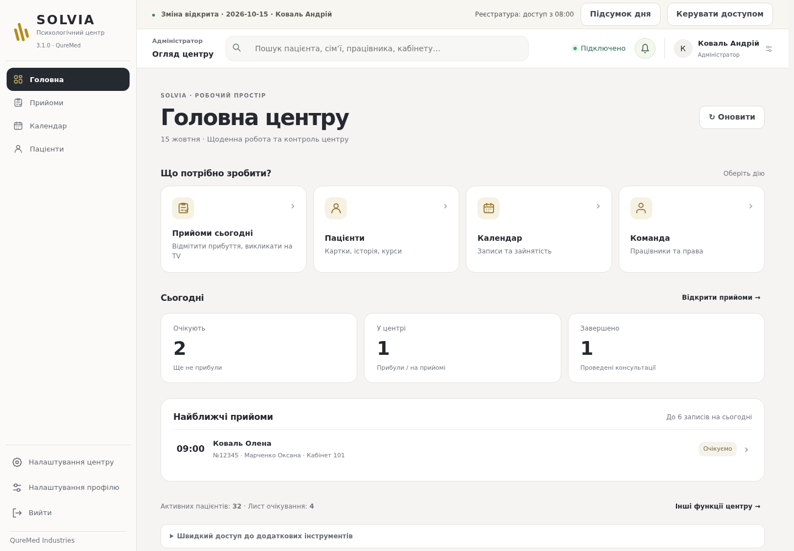
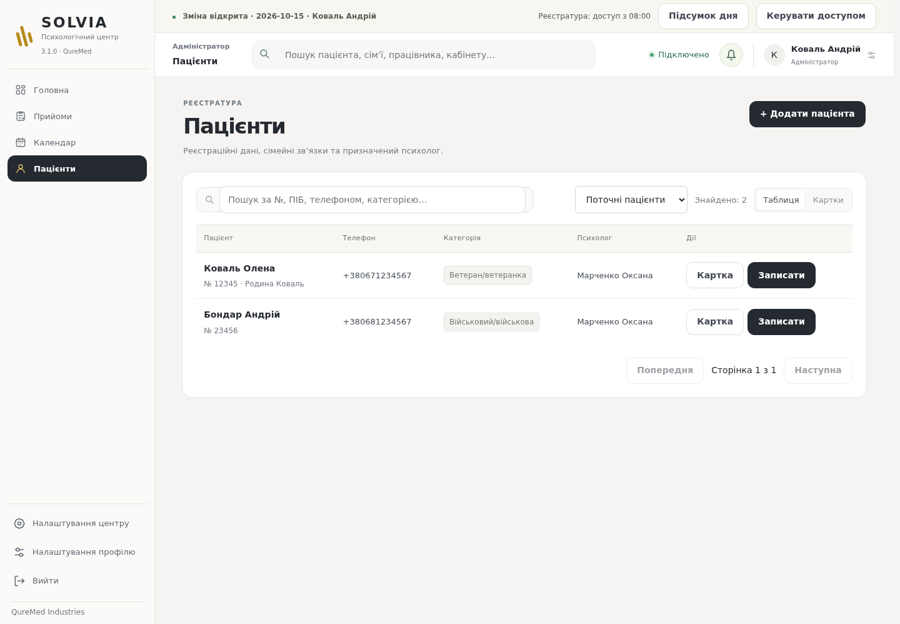
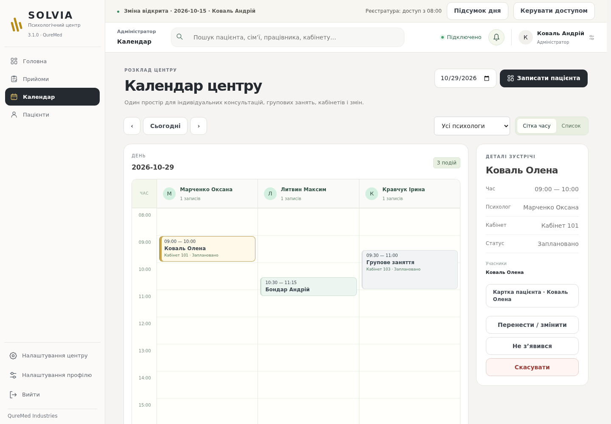

# Світлий інтерфейс SOLVIA 3.1

Подальший варіант із панеллю іконок і верхніми вкладками: [SOLVIA Studio Workspace](STUDIO-WORKSPACE.md).

Продовження `feature/rehab-center-readiness`. Зразок використано для оформлення самої програми: світлий фон, вільний простір, темні основні кнопки й стриманий золотий акцент SOLVIA. Навігація залишається розділеною за ролями; усі додаткові функції доступні через каталог розділів.

Змінено оформлення бічної панелі, головної центру, карток пацієнтів, календаря, таблиць і діалогів. Другорядні елементи не конкурують з основною дією. Збережено окремі кольори статусів, клавіатурний фокус, адаптивність та наявні правила друку. Нових анімацій, зовнішніх шрифтів і сторонніх мережевих залежностей немає.

Зміна оформлення не змінює API, дані, дозволи або логіку запису/консультацій. Для наявних Linux/Windows клієнтів потрібне звичайне оновлення frontend у складі перевіреного пакета; ці зміни самі не встановлюються на робочі місця центру.

Production-збірка та 11 браузерних наборів пройшли: чотири ролі, навігація, короткі екрани й мобільна ширина, запис/перенесення, календарні помилки, документи/друк, чернетки, повідомлення, оновлення та TV. Прев’ю нижче містять виключно синтетичні дані.

## Головна центру

## Пацієнти

## Календар

