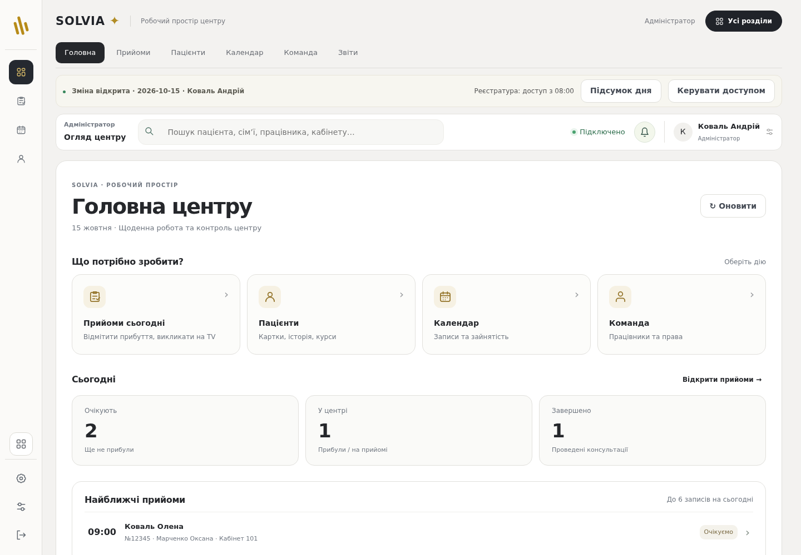
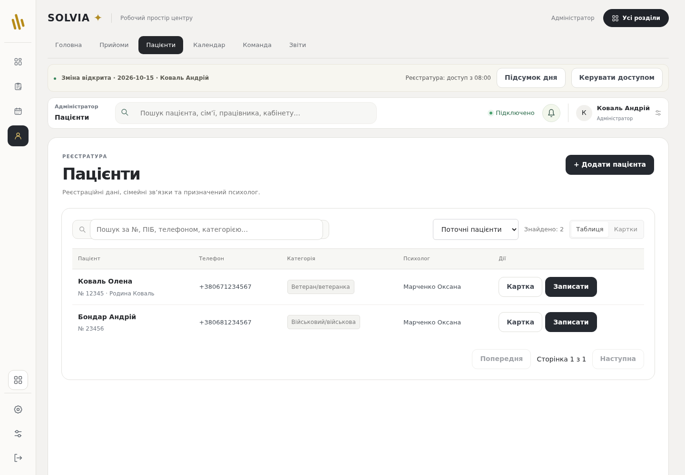
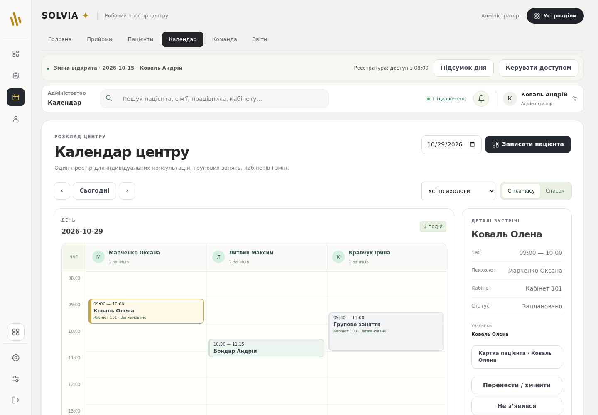

# SOLVIA — робочий простір у стилі студії

Візуальна основа — світла структура редактора HyperFrames: вузька панель інструментів ліворуч, горизонтальні вкладки зверху, темний активний розділ і велика біла робоча область. Назва, дані, функції й дозволи залишаються SOLVIA. Відеоредактора, шкали часу чи декоративних непрацюючих кнопок у програмі немає.

- Іконки зліва ведуть до основних розділів; назви доступні для скринридера й у підказках. Налаштування та вихід залишаються внизу.
- Вкладки відкривають справжні сторінки центру. Набір залежить від ролі. Після відкриття додаткового розділу його вкладка з’являється поруч.
- «Усі розділи» відкриває наявний каталог функцій: команда, кабінети, черги, документи, супервізії та інші дозволені інструменти.
- Календар зберігає деталі прийому праворуч; усі форми, пацієнти, консультації та друк працюють через наявну логіку.
- На вузьких екранах збережено меню; вкладки прокручуються всередині своєї панелі. Є клавіатурний фокус і виділення активної вкладки.

Перевірено production-збірку та 11 браузерних наборів. Додано перевірку справжнього переходу «Календар → Головна» через вкладки та відсутності клінічної вкладки пацієнтів у керівника. Виявлене під час розробки горизонтальне переповнення на телефонній ширині усунено.

Це оновлення коду в гілці `feature/rehab-center-readiness`, ще не встановлений випуск для робочих місць центру. Усі дані на знімках синтетичні.

## Головна

## Пацієнти

## Календар

